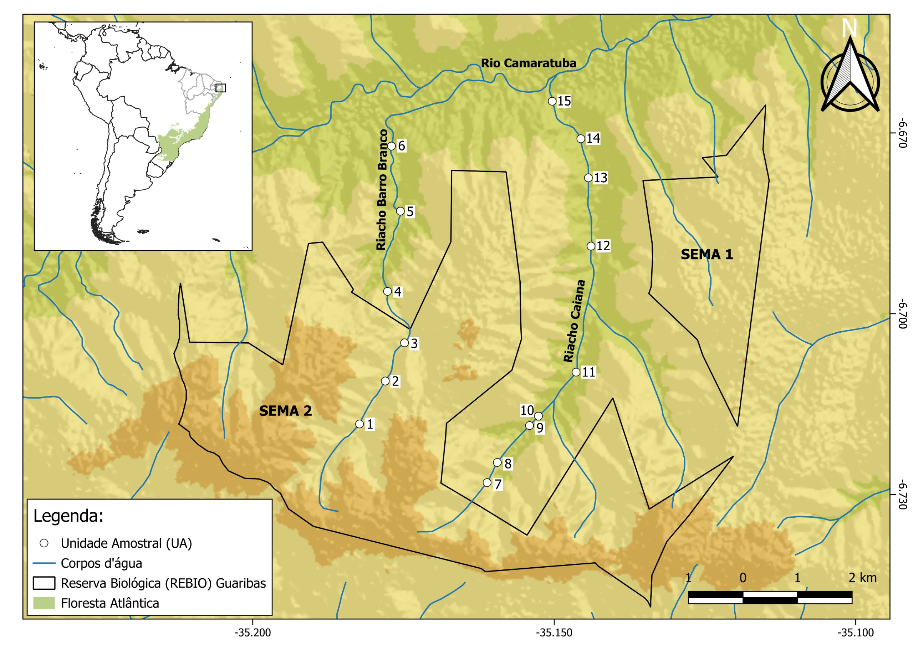

# Introdução

A Floresta Atlântica está entre os principais domínios de florestas tropicais e subtropicais úmidas do Brasil apresentando variações no relevo e na vegetação ao longo de sua distribuição[@olson2001; @massante2023]. Essa variação gera heterogeneidade ambiental, o que contribui para sua rica biodiversidade, que inclui espécies raras e endêmicas, muitas delas ameaçadas de extinção [@tabarelli2010; @marques2021]. Entretanto, a Floresta Atlântica apresenta um longo histórico de ocupação e uso da terra, que contribuiu para a redução de sua cobertura vegetal original [@fonseca1985], sendo que grande parte da vegetação remanescente encontra-se distribuída em pequenos fragmentos, geralmente isolados entre si e sujeitos à influência dos efeitos de borda [@vancine2024; @molinez2024]. A combinação de sua rica biodiversidade e de seu elevado endemismo, somada à intensa perda de habitat, levou ao seu reconhecimento como um dos principais *hotspots* mundiais de conservação [@myers2000].

Diante desse cenário, as unidades de conservação tornam-se uma estratégia para proteger os remanescentes de Floresta Atlântica, contribuindo para a manutenção da cobertura vegetal e da biodiversidade [@lima2020; @souza2021; @zuñe2025], tendo como objetivo a preservação integral dos ecossistemas e a manutenção de suas condições naturais dentro de seus limites [@brasil2000]. No entanto, a proteção legal não garante, por si só, que essas condições sejam mantidas, tornando necessário o acompanhamento das áreas protegidas para avaliar sua efetividade [@oliveira2017; @faria2021; @barros2022; @chen2023; @witt2023; @simeão2026]. Para esse acompanhamento, os ecossistemas aquáticos inseridos nos remanescentes florestais podem ser utilizados como indicadores das condições ambientais, entre os quais se destacam os riachos, por serem sistemas que sofrem interferência direta do ambiente terrestre, especialmente pela vegetação ripária [@fisher1996; @silva-araújo2020; @oliveira2025].

A vegetação ripária corresponde à vegetação presente nas margens dos riachos, formando uma faixa de transição entre os ambientes terrestre e aquático, contribuindo para o controle da entrada de nutrientes e sedimentos, o fornecimento de matéria orgânica e a regulação da incidência de luz e da temperatura nos riachos [@naiman1997; @beltrão2009; @tonello2021]. Dessa forma, a vegetação ripária favorece a manutenção de habitats e a disponibilidade de recursos para os organismos aquáticos [@oester2026; @ye2024; @zhang2024]. Entretanto, interferências antrópicas, como a substituição ou remoção da vegetação ripária, podem comprometer essas funções, alterando a retenção de nutrientes, sedimentos e contaminantes e, consequentemente, as condições do habitat e a qualidade da água [@ebling2024; @fachinelli2023]. Essas alterações podem refletir na composição e nas características funcionais das comunidades aquáticas [@andriotti2022; @hepp2023; @aggio2022; @amaral2022; @bomfim2023]. Além disso, a variação das condições ambientais no espaço e no tempo podem contribuir para diferentes respostas das comunidades, influenciando sua estrutura e organização [@santos2025; @gomes2020; @souza2023; @giongo2023; @silva2024].

Além da ação humana, fatores naturais, como a sazonalidade, também influenciam o funcionamento dos ecossistemas aquáticos em regiões tropicais, onde a alternância entre os períodos chuvosos e secos modifica a dinâmica dos riachos [@maltchik2006; @milesi2024; @barboza2024]. Durante o período chuvoso, o aumento do escoamento pode elevar a velocidade da água, o transporte e a deposição de sedimentos, bem como a entrada de matéria orgânica e nutrientes [@magalhães2022; @tadeu2025]. No período seco, a redução da vazão pode favorecer a formação de poças e remansos e modificar a disponibilidade de recursos e micro-hábitats [@silva2017; @costa2026]. Dessa forma, a sazonalidade pode alterar simultaneamente as condições ambientais e a estrutura do habitat, influenciando a organização das comunidades aquáticas.

Entre as comunidades que melhor respondem a essas variações está o zooplâncton. O zooplâncton compreende a comunidade de organismos heterotróficos que vivem na coluna d'água e apresentam capacidade limitada de locomoção, sendo influenciados pelo movimento da água [@tundisi2008; @esteves2011]. Embora seja tradicionalmente associado a ambientes lênticos, esse grupo também ocorre em sistemas lóticos, sobretudo em locais de menor velocidade da água, como margens protegidas, poças e remansos [@walks2007; @castilho-noll2023]. Sua ocorrência nesses ambientes está relacionada às condições locais e à disponibilidade de habitats favoráveis à sua permanência [@gomes2020; @gutierrez2022; @santos2026].

A comunidade zooplanctônica é sensível às variações que ocorrem no ambiente e pode responder rapidamente a mudanças nas condições locais. As condições físico-químicas da água, como temperatura, oxigênio dissolvido e condutividade, podem afetar a ocorrência e a densidade dos organismos, enquanto a heterogeneidade espacial está relacionada à disponibilidade de micro-hábitats e áreas de retenção [@riis2020; @aggio2022; @bomfim2022; @bomfim2024]. A vegetação ripária também exerce papel importante nessa dinâmica, ao regular a entrada de luz, matéria orgânica e sedimentos, influenciando as condições ambientais e a disponibilidade de recursos [@ono2020; @bega2024]. Em conjunto, esses fatores podem determinar diferentes padrões na composição e na densidade da comunidade zooplanctônica.

Apesar da importância desses componentes, o zooplâncton de riachos permanece menos estudado do que aquele associado a ambientes lênticos, especialmente em regiões tropicais [@bomfim2024]. Essa lacuna torna-se relevante porque a dinâmica hidrológica, a heterogeneidade do habitat e a conexão entre os riachos e o ambiente terrestre podem produzir padrões de organização diferentes daqueles observados em lagos e reservatórios [@amaral2022; @ribeiro2022; @gomes2020; @ramos2022]. Nesse sentido, a vegetação ripária e as características físico-químicas da água podem influenciar a composição da comunidade zooplanctônica, uma vez que alterações nessas condições podem modificar os recursos e as condições disponíveis para os organismos. Assim, a identificação das variáveis ambientais associadas à comunidades aquáticas, como o zooplâncton, permite compreender quais variáveis ambientais apresentam maior associação com relação a sua composição [@stenert2008; @maltchik2010; @simião-ferreira2026]. Diante disso, este estudo busca identificar os principais preditores ambientais associados à composição da comunidade zooplanctônica em riachos inseridos em um remanescente de Floresta Atlântica, considerando diferentes níveis de preservação ambiental.

# Perguntas

O presente estudo propõe-se a responder às seguintes questões:

1.  Como as condições ambientais e a composição da comunidade zooplanctônica variam ao longo do gradiente de preservação dos riachos?

2.  Quais variáveis ambientais estão associadas à variação na composição da comunidade zooplanctônica e quais apresentam maior contribuição para explicá-la?

3.  Quais táxons estão associados às diferentes condições ambientais observadas nos riachos?

# Hipóteses

1.  **Variação das condições ambientais e da composição da comunidade:** As mudanças no uso e cobertura do solo bem como alterações na vegetação ripária podem modificar a estrutura do habitat e as características físico-químicas da água, alterando as condições e a disponibilidade de recursos para os organismos. Assim, espera-se que a composição da comunidade zooplanctônica responda a essas mudanças e varie ao longo do gradiente de preservação, acompanhando essas alterações ambientais.
2.  **Associação entre os preditores ambientais e a comunidade zooplanctônica:** A comunidade zooplanctônica é sensível às mudanças nas condições ambientais, podendo apresentar alterações em sua composição. Dessa forma, espera-se que parte da variação na composição da comunidade zooplanctônica seja explicada pelas condições ambientais dos riachos, com algumas variáveis apresentando maior contribuições para explicar essa variação do que outras.
3.  **Táxons indicadores:** Espera-se que determinados táxons da comunidade zooplanctônica apresentem maior associação com algum nivel de preservação ambiental, em resposta às condições características de cada nível, podendo atuar como bioindicadores dessas condições.

# Objetivos

## Objetivo Geral

Identificar os principais preditores ambientais associados à composição da comunidade zooplanctônica em riachos de um remanescente de Floresta Atlântica sob diferentes níveis de preservação ambiental.

## Objetivos Específicos

-   Caracterizar os principais gradientes de estrutura do habitat e das condições ambientais ao longo dos riachos, considerando diferentes níveis de preservação.

-   Avaliar a variação na composição da comunidade zooplanctônica ao longo do gradiente de preservação.

-   Determinar quais preditores ambientais apresentam maior contribuição para explicar a variação na composição da comunidade zooplanctônica.

-   Identificar os táxons que funcionam como especies indicadoras associados às diferentes condições ambientais observadas ao longo dos riachos.

# Material e Métodos

## Área de estudo e delineamento amostral

O estudo foi realizado na Reserva Biológica Guaribas (REBIO Guaribas), uma unidade de conservação federal localizada no estado da Paraíba. Criada em 1990, a REBIO Guaribas é constituída por três fragmentos descontínuos, denominados SEMA 01, SEMA 02 e SEMA 03, que representam um dos últimos remanescentes de Floresta Atlântica na região. A vegetação da REBIO é composta principalmente por floresta estacional semidecidual e formações savânicas, estando a unidade localizada em uma zona de transição entre as ecorregiões da Caatinga e da Mata Atlântica. A área de estudo está inserida principalmente no município de Mamanguape, abrangendo também os municípios de Rio Tinto, Curral de Cima, Jacaraú e Marcação, em uma região caracterizada pelo predomínio de áreas agrícolas [@mma2003]. O entorno da REBIO Guaribas apresenta diferentes formas de uso e cobertura do solo, com predominância de áreas destinadas à agricultura, pastagens e pequenas propriedades rurais [@mma2026; @arruda2013]. Entre as principais atividades desenvolvidas na região estão o cultivo de cana-de-açúcar, abacaxi e coqueiro, além da pecuária e roçados de subsistência [@heinrichs2017; @gouveia2017]. Esses usos do solo podem influenciar os ambientes aquáticos adjacentes por meio do escoamento superficial, da alteração da vegetação ripária e do aporte de sedimentos, nutrientes e outros materiais pelo assoreamento de córregos e contaminação das águas subterrâneas [@mma2003; @soler2004].

A rede hidrográfica da região é composta predominantemente por pequenas bacias, com córregos de primeira e segunda ordem, segundo a classificação de Strahler [@strahler1957]. Entre eles, destacam-se os riachos Barro Branco e Caiana, ambos pertencentes à bacia hidrográfica do rio Camaratuba e selecionados como áreas de estudo deste trabalho, localizados no fragmento SEMA 02 da REBIO Guaribas. O riacho Barro Branco possui aproximadamente 8,8 km de extensão e sua nascente está localizada no interior da REBIO Guaribas. Seu trecho superior está inserido nos limites da unidade de conservação, enquanto os trechos médio e inferior se estendem para a área de entorno. Apesar dessa transição, a vegetação ripária permanece preservada ao longo da maior parte do riacho. O riacho Caiana possui aproximadamente 9,8 km de extensão e também tem sua nascente no interior da REBIO, porém a maior parte de seu curso está situada fora dos limites da unidade de conservação.

O clima da região é classificado como As', segundo Köppen-Geiger [@peel2007], com temperatura média anual de aproximadamente 25 °C e baixa amplitude térmica anual. As temperaturas máximas ocorrem principalmente entre fevereiro e março. A precipitação anual varia de 1.400 a 1.800 mm, concentrando-se entre março e julho, período que se estende do outono ao inverno, enquanto os menores níveis de precipitação ocorrem entre setembro e dezembro. Esse padrão está relacionado à influência de massas de ar frio provenientes do Oceano Atlântico Sul, que afetam a região [@gouveia2017].

A amostragem foi realizada durante o período seco entre novembro de 2023 e fevereiro de 2024 e o período chuvoso entre junho e agosto de 2024. Foram estabelecidos 15 pontos amostrais (P), distribuídos longitudinalmente nos riachos Barro Branco e Caiana, abrangendo diferentes níveis de preservação ambiental e de influência antrópica (@fig-mapa). No riacho Barro Branco, foram estabelecidos seis pontos amostrais (P1 a P6), sendo os pontos 1 a 3 localizados no interior da REBIO e do 4 ao 6 na zona de amortecimento. No riacho Caiana, foram estabelecidos nove pontos amostrais (P7 a P15), todos localizados fora dos limites da unidade de conservação, em trechos sob maior influência de áreas de pastagem e cultivo agrícola. Em cada ponto foram realizadas três subamostragens em diferentes habitats, totalizando 45 subamostras (15 Pontos × 3 subamostras) por período sazonal. Esse delineamento permitiu avaliar a variação espacial das condições ambientais, das características do habitat e da composição da comunidade zooplanctônica em diferentes níveis de preservação e influência antrópica.

Para fins de comparação, os pontos amostrais foram classificadas *a priori* em quatro tipos, considerando o nível de preservação ambiental e as características observadas no entorno e no próprio trecho amostrado. A classificação foi baseada principalmente na condição da vegetação ripária, no uso e cobertura do solo adjacente e nas características do habitat e da qualidade da água. Dessa forma, os quatro tipos foram organizados em um gradiente de preservação, desde trechos com condições mais preservadas até aqueles sob maior influência antrópica. A definição das categorias foi realizada antes da análise das respostas biológicas, permitindo que o nível de preservação fosse considerado uma característica espacial independente dessas respostas.

-   **Tipo I\*:** corresponde aos pontos localizadas no interior da área protegida e que apresentam condições relativamente preservadas, caracterizadas pela presença de vegetação ripária íntegra e ausência de áreas de cultivo nas proximidades, considerando uma distância mínima de 1 km. Esses pontos de amonstragem também atendem aos critérios de qualidade da água estabelecidos como referência, com temperatura média ≤ 28 °C, concentração média de oxigênio dissolvido ≥ 6 mg/L, velocidade média da água ≥ 0,025 m/s e turbidez média ≤ 15 NTU.

-   **Tipo II:** pontos localizados no interior da área protegida, mas que apresentam algum grau de alteração ambiental. Essas alterações podem estar relacionadas à proximidade de áreas de cultivo ou a desvios em uma ou mais das características hidrológicas e de qualidade da água utilizadas como referência para o Tipo I\*.

-   **Tipo III:** corresponde aos pontos amostrais localizados fora da área protegida, mas que apresentam condições de qualidade da água relativamente boas, comparáveis às observadas nos pontos classificados como sendo do Tipo I\*. Esses pontos podem, entretanto, apresentar diferenças em outras características ambientais graças à localização fora da área protegida.

-   **Tipo IV:** os pontos localizados fora da área protegida e que apresentam evidências de perturbação ambiental. Essas alterações incluem condições de qualidade da água inferiores às observadas nos pontos de referência, não atendendo a pelo menos um dos critérios estabelecidos para o Tipo I\*, e/ou alterações nas características do habitat.

Para os pontos amostrais dos Tipos III e IV, não foram considerados os critérios de proximidade da vegetação ripária e das áreas de cultivo utilizados na definição dos Tipos I\* e II. Por estarem localizados fora da REBIO Guaribas, esses pontos estão sujeitos a diferentes condições de uso e cobertura do solo e, portanto, não se espera que apresentem vegetação ripária íntegra ou distância mínima de 1 km de áreas de cultivo. As categorias definidas *a priori* foram posteriormente avaliadas com base nas medições das variáveis ambientais realizadas em campo.

## Coleta de dados ambientais

Para caracterizar as condições ambientais de cada ponto, foram avaliados quatro conjuntos de variáveis: (a) morfologia do local, (b) qualidade da água, (c) composição do sedimento e (d) estrutura do habitat marginal. A morfologia do local foi caracterizada pela medição da largura (cm) e da profundidade (cm) do curso d'água em três transectos selecionados aleatoriamente, utilizando trena métrica. A inclinação das margens foi classificada como 1 para declive de até 20°, 2 para declive de 20 a 30°, 3 para declive entre 30 e 50° e 4 para declive das margens superior a 50°. Variáveis em escala de bacia hidrográfica, como altitude, comprimento do curso d'água, forma dos ambientes e distância entre os pontos amostrais, foram obtidas utilizando GPS portátil e imagens de satélite [@medeiros2008].

A qualidade da água foi avaliada por meio de variáveis físico-químicas. Em campo, foram medidos o oxigênio dissolvido (mg/L) e a temperatura da água (°C) por meio de oxímetro portátil (LUTRON DO-5510). A velocidade da corrente (m/s) foi estimada pelo método do flutuador descrito por @maitland1990. Em laboratório, no Laboratório de Ecologia da UEPB – Campus V, foram determinados os valores de pH (TECNOPON MPA-210), condutividade elétrica (TECNOPON MCS-150) e turbidez, utilizando turbidímetro com base em amostras de água coletadas em cada ponto amostral.

A composição do sedimento e a estrutura física do habitat foram avaliadas seguindo protocolos propostos por @pusey2004 e @mugodo2006, adaptados por @medeiros2008. Essas variáveis foram estimadas a partir de 9 a 12 quadrantes de um metro distribuídos ao longo das margens do curso d'água (interface terrestre-aquática), por meio de transectos paralelos às margens dos corpos d'água, representando a proporção média (%) de cobertura dos atributos avaliados. Dentro de cada quadrante, a porcentagem de cobertura dos tipos de sedimento (lama, areia, seixos, cascalho fino, cascalho grosso, rochas e rocha matriz) e da estrutura do habitat marginal e subaquático foi estimada visualmente. As variáveis de estrutura do habitat incluíram macrófitas aquáticas, gramíneas marginais, serapilheira, algas aderidas e filamentosas, cobertura vegetação, vegetação submersa, liteira, detritos lenhosos, massas radiculares, raízes e galhos.

## Coleta do zooplâncton

O zooplâncton foi coletado quantitativamente utilizando uma rede de plâncton com abertura de 30 cm de diâmetro, 70 cm de comprimento e malha de 68 μm. Em cada unidade amostral, foram definidos três tipos distintos de hábitat, sendo filtrados 50 L de água por hábitat, totalizando 150 L por unidade amostral. O material retido na rede foi transferido para frascos plásticos graduados de 80 mL [@pinto-coelho2004]. As amostras foram anestesiadas com água gasosa comercial (CO₂) e posteriormente fixadas em formalina a 4%, neutralizada com sacarose, com o objetivo de reduzir distorções estruturais, evitar a perda de ovos e garantir a preservação das características morfológicas necessárias à identificação taxonômica [@haney1973]. No laboratório, todo o volume concentrado de cada amostra foi analisado, sendo os indivíduos identificados até o menor nível taxonômico possível e contados em câmara de contagem do tipo Sedgwick–Rafter (1 mL), com auxílio de microscópio óptico (Olympus CX31), chaves de identificação especializadas e outros materiais de apoio como @elmoor-loureiro1997; @koste1987 e @joko2011. As análises foram realizadas no Laboratório de Ecologia da Universidade Estadual da Paraíba (UEPB), Campus V, e apenas rotíferos, cladóceros e copépodes foram considerados no presente estudo.

## Análise de dados

Inicialmente, as variáveis ambientais foram avaliadas quanto à correlação entre si, com o objetivo de identificar variáveis redundantes. As variáveis que apresentaram elevada correlação foram excluídas das análises posteriores, evitando a sobreposição de informações entre os preditores ambientais [@legendre1998].

```{r env-str23_org}
#| eval: false
#| message: false
#| warning: false
#| code-fold: true
#| code-overflow: wrap
#| code-summary: "Código: Importação e organização dos dados ambientais"
#| results: false

#str23 - ORGANIZANDO DADOS----

dev.off() #apaga os graficos, se houver algum
rm(list=ls(all=TRUE)) #limpa a memória
cat("\014") #limpa o console
getwd()
library(openxlsx)

##CARREGANDO MATRIZES BRUTAS----

habitat <- read.xlsx("data/rebio23-habitat.xlsx",
                     rowNames = T,
                     colNames = T,
                     sheet = "ambiente",
                     rows = 2:98) #startRow = 2

t_grps <- read.xlsx("data/rebio23-habitat.xlsx",
                    rowNames = T,
                    colNames = T,
                    sheet = "grupos",
                    rows = 2:98) #startRow = 2

###### DELETANDO O PONTO 11
del_rows <- c("C-C-P11-H1", "C-C-P11-H2", "C-C-P11-H3",
              "S-C-P11-H1", "S-C-P11-H2", "S-C-P11-H3")
del_rows
habitat <- habitat[!(row.names(habitat) %in% c(del_rows)),]
habitat

rownames(t_grps)
del_rows

t_grps <- t_grps[!(rownames(t_grps) %in% del_rows),]

t_grps

###REMOVENDO COLUNAS ZERADAS DE HABITAT----


habitat[is.na(habitat)] <- 0
habitat

sum <- colSums(habitat)
sum
zero_sum <- names(which(colSums(habitat) == 0))
zero_sum #nomes das colunas zeradas
m_part_cols <- habitat[(colSums(habitat) != 0)] #em != a exclamação inverte o sentido
zero_sum2 <- names(which(colSums(m_part_cols) == 0))
zero_sum2 #nomes das colunas zeradas
sum<-colSums(m_part_cols)
sum

###SEPARANDO NUTRIENTES----

nutri <- grep("^n\\.", colnames(m_part_cols), value = TRUE)
nutri
nutrientes <- m_part_cols[, nutri, drop = FALSE]

m_hab <- m_part_cols[, !colnames(m_part_cols) %in% nutri, drop = FALSE]
colnames(m_hab)

##SALVANDO MATRIZES FINAIS----

write.table(m_hab, "m_hab.csv",
            sep = ";", dec = ".", #"\t",
            row.names = TRUE,
            quote = TRUE,
            append = FALSE)
write.table(nutrientes, "t_nutri.csv",
            sep = ";", dec = ".", #"\t",
            row.names = TRUE,
            quote = TRUE,
            append = FALSE)
write.table(t_grps, "t_grps.csv",
            sep = ";", dec = ".", #"\t",
            row.names = TRUE,
            quote = TRUE,
            append = FALSE)

##TRAZENDO DE VOLTA----
t_grps <- read.csv("t_grps.csv",
                   sep = ";", dec = ".",
                   row.names = 1,
                   header = TRUE,
                   na.strings = NA)
t_nutri <- read.csv("t_nutri.csv",
                  sep = ";", dec = ".",
                  row.names = 1,
                  header = TRUE,
                  na.strings = NA)
m_hab <- read.csv("m_hab.csv",
                  sep = ";", dec = ".",
                  row.names = 1,
                  header = TRUE,
                  na.strings = NA)
```

```{r env-str23_corr}
#| eval: false
#| warning: false
#| message: false
#| results: false
#| code-fold: true
#| code-overflow: wrap
#| code-summary: "Código: Correlações dos dados ambientais" 

#str23----

##ORGANIZANDO DADOS----

dev.off()
rm(list=ls(all=TRUE))
cat("\014")

t_grps <- read.csv("t_grps.csv",
                   sep = ";", dec = ".",
                   row.names = 1,
                   header = TRUE,
                   na.strings = NA)
m_hab <- read.csv("m_hab.csv",
                  sep = ";", dec = ".",
                  row.names = 1,
                  header = TRUE,
                  na.strings = NA)

##CORRELOGRAMA E REMOÇÃO DE VARIÁVEIS REDUNDANTES OU DESNECESSÁRIAS----

library(psych)
colnames(m_hab)

png("fig-h.hab_pairs.png")
pairs.panels(m_hab[,15:24],
             method = "pearson", # correlation method
             scale = FALSE, lm = FALSE,
             hist.col = "#00AFBB", pch = 19,
             density = TRUE,  # show density plots
             ellipses = TRUE, # show correlation ellipses
             alpha = 0.5)
dev.off()

cor <- cor(m_hab)
cor

library(corrplot)
png("fig-hab_corrplot.png")
corrplot(cor, method = "circle")
dev.off()

##DELETANDO COLINEARES OU INDESEJADAS----

sink(file = "colineares.txt", append = FALSE, split = TRUE)
colnames(m_hab)
del_cols <- c(
  "m.Depth_max_cm",
  "m.Depth_mar_cm",
  grep("^n\\.", colnames(m_hab), value = TRUE)
)
m_hab_part <- m_hab[, !(colnames(m_hab) %in% del_cols)]
sink()

##SOMANDO REDUNDANTES----

m_hab_part$h.Algae <- m_hab_part$h.Algae_f + m_hab_part$h.Algae_a
m_hab_part <- m_hab_part[, !(colnames(m_hab_part)
                           %in% c("h.Algae_f", "h.Algae_a"))]
m_hab_part$h.Debris <- m_hab_part$h.Debris_l + m_hab_part$h.Debris_s
m_hab_part <- m_hab_part[, !(colnames(m_hab_part)
                         %in% c("h.Debris_l", "h.Debris_s"))]

colnames(m_hab_part)
m_hab_part
sink()

write.table(m_hab_part, "m_hab_part.csv",
            sep = ";", dec = ".", #"\t",
            row.names = TRUE,
            quote = TRUE,
            append = FALSE)
m_hab_part <- read.csv("m_hab_part.csv",
                       sep = ";", dec = ".",
                       row.names = 1,
                       header = TRUE,
                       na.strings = NA)
```

```{r env-str23_corr_test}
#| eval: false
#| warning: false
#| message: false
#| results: false
#| code-fold: true
#| code-overflow: wrap
#| code-summary: "Código: Testes de correlação dos dados ambientais" 

colnames(m_hab_part)
#install.packages("PerformanceAnalytics")
library(PerformanceAnalytics)
chart.Correlation(m_hab_part[, c(11:22)], histogram=TRUE)
# ***p<0.001, **p<0.01, *p<0.05, .p<0.10

#install.packages("Hmisc")
library(Hmisc)
mat <- as.matrix(m_hab_part[, 11:22])
res <- rcorr(mat, type = "pearson")
cor_mat <- res$r
p_mat   <- res$P

stars <- ifelse(p_mat < 0.001, "***",
         ifelse(p_mat < 0.01,  "**",
         ifelse(p_mat < 0.05,  "*", "")))

cor_star <- ifelse(p_mat < 0.05,
                   paste0(round(cor_mat, 2), stars),
                   NA)

cor_star <- matrix(
  cor_star,
  nrow = nrow(cor_mat),
  dimnames = dimnames(cor_mat)
)

cor_star[upper.tri(cor_star, diag = TRUE)] <- NA
cor_star <- noquote(cor_star)
print(cor_star, na.print = "")
```

Após essa etapa, as variáveis ambientais foram transformadas de acordo com sua natureza. As variáveis relacionadas à morfologia do local e à qualidade da água foram transformadas pela raiz quadrada, enquanto as variáveis de composição do sedimento e de estrutura do habitat marginal, expressas em porcentagem, foram relativizadas pelo total da coluna e transformadas pelo arco seno da raiz quadrada [@mccune2002]. A matriz ambiental resultante foi utilizada na Análise de Componentes Principais (PCA), com o objetivo de avaliar os principais gradientes ambientais e a distribuição das unidades amostrais em relação às variáveis ambientais. A PCA foi realizada utilizando o pacote `FactoMineR` no ambiente R [@lê2008]. A diferença nas condições ambientais entre os tipos I, II, III e IV, classificados de acordo com o nível de preservação ambiental, foi avaliada por meio da Análise de Variância Multivariada Permutacional (PERMANOVA), com 999 permutações [@anderson2001].

```{r env-PCA_org}
#| eval: false
#| warning: false
#| message: false
#| results: hide
#| code-fold: true
#| code-overflow: wrap
#| code-summary: "Código: Organização dos dados ambientais para a PCA"

#PCA fviz package----
#browseURL("https://www.sthda.com/english/articles/31-principal-component-methods-in-r-practical-guide/112-pca-principal-component-analysis-essentials/")

#ORGANIZANDO DADOS----

dev.off()
rm(list=ls(all=TRUE))
cat("\014")

t_grps <- read.csv("t_grps.csv",
                   sep = ";", dec = ".",
                   row.names = 1,
                   header = TRUE,
                   na.strings = NA)
m_hab_part <- read.csv("m_hab_part.csv",
                       sep = ";", dec = ".",
                       row.names = 1,
                       header = TRUE,
                       na.strings = NA)

colnames(m_hab_part)

###RELATIVIZAÇÕES E TRANSFORMAÇÕES----
library(vegan)
library(tidyverse)

# Selecionando variáveis que começam com "w" ou "m"
m_wm <- m_hab_part[, grep("^(w|m)", colnames(m_hab_part))]

# Selecionando variáveis que começam com "s" ou "h"
m_sh <- m_hab_part[, grep("^(s|h)", colnames(m_hab_part))]

# Removendo os dois primeiros caracteres dos nomes das colunas
colnames(m_wm) <- sub("^..", "", colnames(m_wm))
colnames(m_sh) <- sub("^..", "", colnames(m_sh))

# Transformações
m_wm <- sqrt(m_wm)
m_sh <- asin(sqrt(decostand(m_sh, method = "total", MARGIN = 2)))

# Juntando tudo em uma única tabela
hab_trns <- cbind(m_sh, m_wm)

# Salvado m_hab_trns
write.table(hab_trns, "m_hab_trns.csv",
            sep = ";", dec = ".", #"\t",
            row.names = TRUE,
            quote = TRUE,
            append = FALSE)
m_hab_trns <- read.table("m_hab_trns.csv",
                         sep = ";", dec = ".",
                         row.names = 1,
                         header = TRUE,
                         na.strings = NA)
```

As análises relacionadas à comunidade zooplanctônica foram realizadas com base na densidade dos táxons, expressa em indivíduos por litro (ind/L), seguindo uma metodologia adaptada de @bowen2017. A densidade de cada táxon foi calculada pela razão entre o número de indivíduos registrados na amostra e o volume total de água filtrado, conforme a fórmula: *Dsp = Nsp/Vf* onde, *Dsp* corresponde à densidade do táxon, em indivíduos por litro; *Nsp* corresponde ao número de indivíduos do táxon registrado na amostra; e *Vf* corresponde ao volume total de água filtrado, em litros. Antes das análises, os dados de densidade foram relativizados e transformados pela raiz quadrada, para reduzir a influência dos táxons mais abundantes e melhorar a distribuição dos dados [@rocha2012].

```{r com-str23_org}
#| eval: false
#| message: false
#| warning: false
#| code-fold: true
#| code-overflow: wrap
#| code-summary: "Código: Importação e organização dos dados comunitários"
#| results: false

#ZOOREBIO23_STR - ORGANIZANDO DADOS DA COMUNIDADE----
#####....----

dev.off() #apaga os graficos, se houver algum
rm(list=ls(all=TRUE)) #limpa a memória
cat("\014") #limpa o console

library(openxlsx)

##CARREGANDO MATRIZES BRUTAS----

densidade <- read.xlsx("data/rebio23-zoopl.xlsx",
                   rowNames = T,
                   colNames = T,
                   sheet = "densidade_hab_indL")

##COLUNAS ZERADAS DE DENSIDADE----
sum <- colSums(densidade)
sum
zero_sum <- names(which(colSums(densidade) == 0))
zero_sum #nomes das espécies zeradas
m_part_cols <- densidade[(colSums(densidade) != 0)] #em != a exclamação inverte o sentido
zero_sum2 <- names(which(colSums(m_part_cols) == 0))
zero_sum2 #nomes das espécies zeradas
sum<-colSums(m_part_cols)
sum

###LINHAS ZERADAS DE DENSIDADE----
m_part2 <- as.data.frame(t(m_part_cols))
sum <- colSums(m_part2)
sum
zero_sum <- names(which(colSums(m_part2) == 0))
zero_sum #nomes das espécies zeradas
m_part_rows <- m_part2[(colSums(m_part2) != 0)] #em != a exclamação inverte o sentido
zero_sum2 <- names(which(colSums(m_part_rows) == 0))
zero_sum2 #nomes das espécies zeradas
sum<-colSums(m_part_rows)
sum
m_dens <- as.data.frame((t(m_part_rows)))

##SALVANDO MATRIZES FINAIS REMOVIDAS AS LINHAS/COLUNAS ZERADAS----

write.table(m_dens, "m_dens.csv",
            sep = ";", dec = ".", #"\t",
            row.names = TRUE,
            quote = TRUE,
            append = FALSE)
m_dens <- read.csv("m_dens.csv",
                   sep = ";", dec = ".",
                   row.names = 1,
                   header = TRUE,
                   na.strings = NA)

#TRANSFORMANDO A MATRIZ DE DENSIDADE

library(vegan)
m_dens_trns <- asin(sqrt(decostand(m_dens,
                               method="total", MARGIN = 2)))

write.table(m_dens_trns, "m_dens_trns.csv",
            sep = ";", dec = ".", #"\t",
            row.names = TRUE,
            quote = TRUE,
            append = FALSE)

m_dens_trns <- read.csv("m_dens_trns.csv",
                   sep = ";", dec = ".",
                   row.names = 1,
                   header = TRUE,
                   na.strings = NA)
```

A composição da comunidade zooplanctônica foi avaliada por meio da Análise de Escalonamento Multidimensional Não Métrico (NMDS), utilizando a matriz transformada de densidade. A NMDS foi utilizada para representar a organização da composição da comunidade entre os pontos amostrais e verificar sua distribuição em relação aos diferentes níveis de preservação ambiental [@clarke1993]. A diferença na composição da comunidade zooplanctônica entre os tipos, classificados segundo o nivel de preservação (I, II, III e IV) foi avaliada por meio da Análise de Variância Multivariada Permutacional (PERMANOVA), com 999 permutações. O teste foi empregado para avaliar se existia variação na composição da comunidade em relação aos diferentes níveis de preservação ambiental [@anderson2001]. A identificação dos táxons associados aos diferentes grupos foi realizada por meio da Análise de Espécies Indicadoras (IndVal), buscando identificar os táxons que apresentaram maior associação com os diferentes níveis de preservação ambiental [@dufrêne1997].

A relação entre a comunidade zooplanctônica e as variáveis ambientais foi avaliada por meio da Análise de Redundância (RDA), utilizando a matriz comunitária de densidade transformada e a matriz de variáveis ambientais previamente selecionada [@legendre1998]. Antes da construção do modelo, a multicolinearidade entre as variáveis explicativas foi avaliada por meio do Fator de Inflação da Variância (VIF), utilizando a função `vif.cca`. Variáveis que apresentaram VIF \> 10 foram consideradas altamente colineares e excluídas da análise [@obrien2007]. Em seguida, as variáveis ambientais restantes foram submetidas ao procedimento de seleção *forward stepwise*, com o objetivo de identificar os preditores que melhor explicaram a variação na estrutura da comunidade zooplanctônica [@blanchet2008]. A significância da RDA e das variáveis selecionadas foi avaliada por meio de testes de permutação, permitindo verificar a contribuição dos preditores ambientais para a variação observada na comunidade [@legendre1998]. Todas as análises foram realizadas no ambiente de programação R [@rcoreteam2023], utilizando principalmente os pacotes `Vegan` [@oksanen] e `FactoMineR` [@lê2008].

# Resultados

## Variáveis ambientais

A condutividade média variou de 98,8 a 223 μS/cm, com maior valor medido no ponto 10, enquanto o pH esteve entre 5,1 a 6,9, com maiores valores nos pontos 14 e 15. A turbidez variou de 4,9 a 79,2 NTU, com maiores valores nos pontos 7, 12 e 13. Entre as características morfológicas, a velocidade da água variou de 0 a 0,41 m/s, com maiores valores nos pontos 14, 9, 12 e 7. A largura variou de 1,1 a 19,5 m, e a profundidade média, de 12,8 a 72,4 cm. A elevação variou de 41,5 a 112,8 m, enquanto a declividade média ficou entre 1,0 e 3,2. O ponto de referência (Ponto 1\*) apresentou velocidade de 0,1 m/s, profundidade de 12,8 cm, largura de 6,2 m e elevação de 107,1 m. A lama e a areia foram os principais componentes do substrato, com proporções médias variando de 1,7 a 100% e de 0 a 98,3%, respectivamente. A lama predominou nos pontos 1 e 2, enquanto a areia apresentou maior contribuição nos pontos 14, 9 e 10. O cascalho fino ocorreu em baixas proporções nos pontos 9, 10 e 13, e as rochas foram registradas apenas no ponto 12. A estrutura do habitat também variou entre os pontos. A cobertura vegetal apresentou médias entre 0,8 e 83,3%, com maiores valores nos pontos 7, 3, 2 e 5, enquanto o ponto 11 apresentou a menor cobertura vegetal. As massas de raízes atingiram 42,5% no ponto 5, enquanto as gramíneas e as macrófitas apresentaram maiores proporções no ponto 11, com 39,2% e 20,8%, respectivamente. A liteira variou de 1,7 a 18,3%, a vegetação submersa, de 0 a 16,7%, e as algas, de 0 a 19,2%. Os detritos apresentaram médias entre 4,2 e 30,8%, com maior contribuição no ponto de referência (@tbl-hab_gttable).

```{r gttable_hab_excel}
#| eval: false
#| warning: false
#| message: false
#| results: false
#| code-fold: true
#| code-overflow: wrap
#| code-summary: "Código: Tabela de dados ambientais" 

#####....----

dev.off() #apaga os graficos, se houver algum
rm(list=ls(all=TRUE)) #limpa a memória
cat("\014") #limpa o console

#TABELA DE HABITAT----

m_hab_part <- read.csv("m_hab_part.csv",
                       sep = ";", dec = ".",
                       row.names = 1,
                       header = TRUE,
                       na.strings = NA)
t_grps <- read.csv("t_grps.csv",
                   sep = ";", dec = ".",
                   row.names = 1,
                   header = TRUE,
                   na.strings = NA)

library(dplyr)
library(tidyr)
m_trab <- m_hab_part %>%
  rename_with(~ gsub("_", ".", .))
m <- m_trab %>%
  group_by(PontoN = t_grps$PontoN) %>%
  summarise(across(where(is.numeric),
                   list(mean = mean, min = min, max = max)),
            .groups = 'drop') %>%
  pivot_longer(
    cols = -c(PontoN),
    names_to = c("Variable", ".value"),
    names_sep = "_"
  )

m <- as.data.frame(m)
m_wide <- m %>%
  mutate(stat_string = ifelse(Variable == c("m.Vel.m.s"),
                              paste0(round(mean, 3), " (", round(min, 3), "-", round(max, 3), ")"),
                              paste0(round(mean, 1), " (", round(min, 1), "-", round(max, 1), ")"))) %>%
  unite("Location", PontoN, sep = "_") %>%
  select(Variable, Location, stat_string) %>%
  pivot_wider(names_from = Location, values_from = stat_string)

m_wide
m_wide <- as.data.frame(m_wide)
m_wide <- m_wide[, c("Variable", "Ponto5", "Ponto6", "Ponto7", "Ponto8", "Ponto9", "Ponto10", "Ponto12", "Ponto13", "Ponto14", "Ponto15", "Ponto16", "Ponto17", "Ponto18", "Ponto19", "Ponto20")] #sequência das colunas (ou linhas)
m_wide

# Salvado m_wide
write.table(m_wide, "m_wide_hab.txt",
            sep = ";", dec = ".", #"\t",
            row.names = TRUE,
            quote = TRUE,
            append = FALSE)
m_wide_hab <- read.table("m_wide_hab.txt",
                  sep = ";", dec = ".",
                  row.names = 1,
                  header = TRUE,
                  na.strings = NA)

# Exportando dados para Excel
library(openxlsx)
#write.xlsx(m_wide, file = "tabela de habitat.xlsx", rowNames = FALSE)
wb <- loadWorkbook("tabela de habitat.xlsx")
writeData(wb, sheet = "Sheet 1", x = m_wide)
saveWorkbook(wb, "tabela de habitat.xlsx", overwrite = TRUE)

### tabela final
library(readxl)
library(gt)

hab_gttable <- read_excel(
  path = "tabela de habitat.xlsx",
  sheet = "tabela_final",
  range = "A1:P26"
)

hab_gttable <- gt(hab_gttable)

hab_gttable <- sub_missing(
  hab_gttable,
  columns = everything(),
  missing_text = ""
)

gtsave(hab_gttable, "gt-hab_gttable_xlsx.html")

saveRDS(hab_gttable, "gt-hab_gttable_xlsx.rds")
```

A Análise de Componentes Principais (PCA) mostrou que os dois primeiros eixos explicaram 40,0% da variação total dos dados, sendo 23,2% pelo primeiro eixo (Dim1) e 16,8% pelo segundo eixo (Dim2). Em relação aos niveis de preservação os pontos do tipo I foram utilizado como referência para a interpretação, o tipo II apresentou maior aproximação na distribuição dos pontos, indicando semelhanças nas condições ambientais, principalmente quanto à elevação, à liteira e ao oxigênio dissolvido. O tipo III foi associado a características como largura do canal, vegetação submersa, gramíneas, macrófitas, lama e algas. O tipo IV apresentou maior dispersão dos pontos, com alguns deles localizados próximos às variáveis areia, velocidade da água e turbidez (@fig-PCA_fviz). Essas diferenças na distribuição entre os níveis de preservação foram corroboradas pela PERMANOVA, que identificou diferenças significativas nas condições ambientais entre os quatro tipos (*F* = 6,23; *R*² = 0,1786; *p* = 0,001), indicando que a classificação dos locais segundo o nível de preservação explicou 17,86% da variação ambiental. Nas comparações pareadas, foram observadas diferenças significativas entre os tipos I e III (*F* = 9,13; *R*² = 0,1858; *p* ajustado = 0,006), I e IV (*F* = 5,30; *R*² = 0,0925; *p* ajustado = 0,006), II e III (*F* = 4,05; *R*² = 0,1065; *p* ajustado = 0,006), II e IV (*F* = 3,46; *R*² = 0,0699; *p* ajustado = 0,006) e III e IV (*F* = 9,39; *R*² = 0,1182; *p* ajustado = 0,006). Não houve diferença significativa entre os tipos I e II (*F* = 2,03; *R*² = 0,1126; *p* ajustado = 0,094), resultado que acompanha a maior proximidade entre esses grupos observada na PCA. De modo geral, os resultados indicaram maior semelhança ambiental entre os tipos I e II, diferenças entre os tipos III e IV e os demais grupos e maior heterogeneidade na distribuição dos pontos do tipo IV.

```{r env-PCA_fviz}
#| eval: false
#| warning: false
#| message: false
#| results: hide
#| code-fold: true
#| code-overflow: wrap
#| code-summary: "Código: Análise de Componentes Principais (PCA) dos dados ambientais"

#PCA fviz package----
#browseURL("https://www.sthda.com/english/articles/31-principal-component-methods-in-r-practical-guide/112-pca-principal-component-analysis-essentials/")

#ORGANIZANDO DADOS----

dev.off()
rm(list=ls(all=TRUE))
cat("\014")

t_grps <- read.csv("t_grps.csv",
                   sep = ";", dec = ".",
                   row.names = 1,
                   header = TRUE,
                   na.strings = NA)
m_hab_trns <- read.csv("m_hab_trns.csv",
                       sep = ";", dec = ".",
                       row.names = 1,
                       header = TRUE,
                       na.strings = NA)

####### matriz de média para habitat
env_completo <- m_hab_trns
library(tidyverse)
m_hab <- env_completo %>%                    
  replace(is.na(.), 0) %>%  #substitui todos os valores NA por 0
  select(where(~sum(.) > 0)) %>%  #mantém apenas colunas cuja soma seja maior que 0
  rownames_to_column("Grupos") %>%
  mutate(Grupos = substr(Grupos, 1, 7),     
         Grupos = factor(Grupos, levels = unique(Grupos))) %>% #mantém a ordem original dos grupos
  group_by(Grupos) %>%                                       
  summarise(across(everything(), mean),                     
            .groups = "drop") %>%                            
  column_to_rownames("Grupos")
m_hab_trns <- m_hab

######## grupos precisa ter o mesmo número de linhas
###################### particionando grupos
m_grups <- t_grps
row.names(m_grups)
pat <- "-H2" 
m_grups <- m_grups[!grepl(pat, rownames(m_grups)), ] #exclui quem começa com pat
pat <- "-H3" 
m_grups <- m_grups[!grepl(pat, rownames(m_grups)), ] #exclui quem começa com pat
################## deletando "H1"
rownames(m_grups) <- gsub("-H1", "", rownames(m_grups))
m_grups
t_grps <- m_grups

#PCA----

library("FactoMineR")
library("factoextra")

pca <- PCA(m_hab_trns, scale.unit = TRUE, ncp = 5, graph = TRUE)
print(pca)

eig.val <- get_eigenvalue(pca)
eig.val

#sink(file = "cor_matrix.txt", append = FALSE)
pca$var$cor
#sink()

fviz_eig(pca, addlabels = TRUE, ylim = c(0,30))

var <- get_pca_var(pca)
var

fviz_pca_var(pca, col.var = "black")

library("corrplot")
corrplot(var$cos2, is.corr=FALSE)

fviz_cos2(pca, choice = "var", axes = 1:2)

fviz_pca_var(pca, col.var = "cos2",
             gradient.cols = c("#00AFBB", "#E7B800", "#FC4E07"),
             repel = TRUE # Avoid text overlapping
)

fviz_pca_var(pca, alpha.var = "cos2")

corrplot(var$contrib, is.corr=FALSE)

fviz_contrib(pca, choice = "var", axes = 1, top = 10)
fviz_contrib(pca, choice = "var", axes = 2, top = 10)
fviz_contrib(pca, choice = "var", axes = 1:2, top = 10)

fviz_pca_var(pca, col.var = "contrib",
             gradient.cols = c("#00AFBB", "#E7B800", "#FC4E07")
)
fviz_pca_var(pca, alpha.var = "contrib")

##GROUPING BY KMEANS----

set.seed(123)
res.km <- kmeans(var$coord, centers = 3, nstart = 25)
grp <- as.factor(res.km$cluster)
# Color variables by groups
fviz_pca_var(pca, col.var = grp,
             palette = c("#0073C2FF", "#EFC000FF", "#868686FF"),
             legend.title = "Cluster")

ind <- get_pca_ind(pca)
ind
ind$contrib

##BIPLOTS----

fviz_pca_ind(pca)

fviz_pca_ind(pca, col.ind = "cos2",
             gradient.cols = c("#00AFBB", "#E7B800", "#FC4E07"),
             repel = TRUE #avoid text overlapping (slow if many points)
)

fviz_pca_ind(pca, pointsize = "cos2",
             pointshape = 21, fill = "#E7B800",
             repel = TRUE #avoid text overlapping (slow if many points)
)

fviz_pca_ind(pca, col.ind = "cos2", pointsize = "cos2",
             gradient.cols = c("#00AFBB", "#E7B800", "#FC4E07"),
             repel = TRUE #avoid text overlapping (slow if many points)
)

fviz_cos2(pca, choice = "ind")

fviz_contrib(pca, choice = "ind", axes = 1:2)

# Create a random continuous variable of length 23,
# Same length as the number of active individuals in the PCA
t_grps <- t_grps[rownames(pca$ind$coord), ]
set.seed(123)
my.cont.var <- t_grps$Ref_site
my.cont.var
# Color individuals by the continuous variable
fviz_pca_ind(
  pca,
  habillage = my.cont.var,
  palette = c("blue", "yellow", "red", "pink"),
  repel = FALSE
)

fviz_pca_ind(pca,
             geom.ind = "point", #show points only (nbut not "text")
             col.ind = as.factor(my.cont.var), #color by groups
             palette = "grey",
             addEllipses = TRUE, #concentration ellipses
             legend.title = "Groups"
)

length(unique(my.cont.var))
fviz_pca_ind(pca,
             geom.ind = "point",
             col.ind = t_grps$Ref_site,
             palette = "grey",
             addEllipses = TRUE, ellipse.type = "confidence",
             mean.point = TRUE,
             legend.title = "Groups")

fviz_pca_biplot(pca, repel = TRUE,
                col.var = "#2E9FDF", #variables color
                col.ind = "#696969"  #individuals color
)

fviz_pca_biplot(pca,
                col.ind = t_grps$Ref_site, palette = "jco",
                addEllipses = TRUE, elipse.type = "euclid",
                label = "var",
                col.var = "black", repel = TRUE,
                legend.title = "Species")

### FILTRANDO AS VARIÁVEIS
var_coord <- pca$var$coord[,1:2]
keep_vars <- apply(abs(var_coord) > 0.5,1,any)
vars_to_keep <- rownames(var_coord)[keep_vars]
pca_filt <- pca
pca_filt$var$coord    <- pca$var$coord[vars_to_keep,,drop=FALSE]
pca_filt$var$cos2     <- pca$var$cos2[vars_to_keep,,drop=FALSE]
pca_filt$var$contrib  <- pca$var$contrib[vars_to_keep,,drop=FALSE]

### AJUSTE MANUAL DAS COORDENADAS DOS VETORES
var_coords <- as.data.frame(pca_filt$var$coord)
var_coords$Dim.1 <- var_coords$Dim.1*4.2
var_coords$Dim.2 <- var_coords$Dim.2*4.2

## Caso queira editar manualmente
#fix(var_coords) #nomes das colunas
#write.table(var_coords,"coords_var.txt")

var_coords <- read.table("coords_var.txt",
                         header=TRUE,
                         row.names=1)

### AJUSTE MANUAL DOS INDIVÍDUOS
#ind_coords <- as.data.frame(pca_filt$ind$coord)

## Caso queira editar manualmente
#fix(ind_coords) #nomes das linhas
#write.table(ind_coords,"coords_ind.txt")

ind_coords <- read.table("coords_ind.txt",
                         header=TRUE,
                         row.names=1)

############################################################
### GRÁFICO FINAL
############################################################

library(factoextra)
library(ggplot2)

t_grps$Ref_site <- as.factor(t_grps$Ref_site)

#png("fig-PCA_fviz.png", width=11, height=9, units="in", res=1000)

library(ggplot2)

ggplot() +
  
  geom_hline(yintercept = 0, linetype = 2) +
  geom_vline(xintercept = 0, linetype = 2) +
  
  geom_point(
    data = ind_coords,
    aes(Dim.1, Dim.2, shape = t_grps$Ref_site),
    size = 2,
    colour = "black"
  ) +
  
  geom_segment(
    data = var_coords,
    aes(x = 0, y = 0,
        xend = Dim.1,
        yend = Dim.2),
    colour = "red",
    arrow = arrow(length = unit(0.25,"cm"))
  ) +
  
  geom_text(
    data = transform(
      var_coords,
      nudge_y = ifelse(Dim.2 >= 0, 0.25, -0.25)
    ),
    aes(
      x = Dim.1,
      y = Dim.2 + nudge_y,
      label = rownames(var_coords)
    ),
    colour = "red",
    size = 4,
    nudge_x = 0.19
  ) +
  
  scale_shape_manual(values = c(15,16,0,1,2,17)) +
  
  labs(
    x = paste0("Dim1 (", round(pca$eig[1,2],1), "%)"),
    y = paste0("Dim2 (", round(pca$eig[2,2],1), "%)"),
    shape = "Tipos"
  ) +
  
  coord_equal() +
  theme_minimal()

#dev.off()
```

```{r env-PERMANOVA_fviz}
#| eval: false
#| warning: false
#| message: false
#| results: hide
#| code-fold: true
#| code-overflow: wrap
#| code-summary: "Código: Teste PERMANOVA - Dados ambientais"

#### Limpando para começar

dev.off()
rm(list = ls(all = TRUE))
cat("\014")

library(vegan)

########## organizando os dados

t_grps <- read.csv(
  "t_grps.csv",
  sep = ";",
  dec = ".",
  row.names = 1,
  header = TRUE,
  na.strings = NA
)

m_hab_trns <- read.csv(
  "m_hab_trns.csv",
  sep = ";",
  dec = ".",
  row.names = 1,
  header = TRUE,
  na.strings = NA
)

# Conferir se as amostras correspondem
if (!setequal(rownames(t_grps), rownames(m_hab_trns))) {
  stop("As amostras de t_grps e m_hab_trns não correspondem.")
}

# Colocar as amostras na mesma ordem
m_trab <- m_hab_trns[rownames(t_grps), , drop = FALSE]

# Manter apenas variáveis ambientais numéricas
m_trab <- m_trab[
  , sapply(m_trab, is.numeric),
  drop = FALSE
]

# Remover amostras com dados ausentes
dados_ok <- complete.cases(m_trab) &
  !is.na(t_grps$Ref_site)

m_trab <- m_trab[dados_ok, , drop = FALSE]
grupos <- droplevels(as.factor(t_grps$Ref_site[dados_ok]))

# Remover variáveis sem variação
variancia <- sapply(m_trab, var)

m_trab <- m_trab[
  , is.finite(variancia) & variancia > 0,
  drop = FALSE
]

# Conferir os dados
print(table(grupos))
print(colnames(m_trab))

# Padronizar as variáveis ambientais
m_env <- scale(m_trab)

# Distância euclidiana
dist_env <- dist(m_env, method = "euclidean")

#### PERMANOVA GERAL

set.seed(123)

perma_geral <- adonis2(
  dist_env ~ grupos,
  permutations = 999
)

print(perma_geral)

####  COMPARAÇÕES PAREADAS ENTRE OS NÍVEIS DE PRESERVAÇÃO

niveis <- levels(grupos)

pares <- combn(niveis, 2, simplify = FALSE)

set.seed(123)

resultados_pares <- lapply(pares, function(par) {
  
  selecao <- grupos %in% par
  
  dados_par <- m_env[selecao, , drop = FALSE]
  grupos_par <- droplevels(grupos[selecao])
  
  dist_par <- dist(dados_par, method = "euclidean")
  
  teste <- adonis2(
    dist_par ~ grupos_par,
    permutations = 999
  )
  
  data.frame(
    Tipo_1 = par[1],
    Tipo_2 = par[2],
    F = teste$F[1],
    R2 = teste$R2[1],
    p = teste$`Pr(>F)`[1]
  )
})

resultados_pares <- do.call(rbind, resultados_pares)

# Corrigir os valores de p para as comparações múltiplas
resultados_pares$p_ajustado <- p.adjust(
  resultados_pares$p,
  method = "holm"
)

resultados_pares$Significativo <- ifelse(
  resultados_pares$p_ajustado < 0.05,
  "Sim",
  "Não"
)

print(resultados_pares)

# 4. PERMDISP — DISPERSÃO DOS GRUPOS

bd <- betadisper(
  dist_env,
  grupos,
  type = "centroid"
)

set.seed(123)

teste_disp <- permutest(
  bd,
  permutations = 999
)

print(teste_disp)


# 5. SALVAR OS RESULTADOS

write.csv(
  as.data.frame(perma_geral),
  "permanova_ambiental_geral.csv",
  row.names = TRUE
)

write.csv(
  resultados_pares,
  "permanova_ambiental_pareada.csv",
  row.names = FALSE
)

capture.output(
  teste_disp,
  file = "permdisp_ambiental.txt"
)


# TABELA EM MATRIZ (OS VALORES DE p SIGNIFICATIVOS EM VERMELHO)

library(knitr)
library(kableExtra)
library(tibble)

# Criar matriz com os tipos de Ref_sites
niveis <- levels(grupos)

pval_matrix <- matrix(
  NA_real_,
  nrow = length(niveis),
  ncol = length(niveis),
  dimnames = list(niveis, niveis)
)

diag(pval_matrix) <- NA_real_

# Preencher a matriz com os p ajustados das comparações pareadas
for (i in seq_len(nrow(resultados_pares))) {
  
  tipo1 <- resultados_pares$Tipo_1[i]
  tipo2 <- resultados_pares$Tipo_2[i]
  p <- resultados_pares$p_ajustado[i]
  
  pval_matrix[tipo1, tipo2] <- p
  pval_matrix[tipo2, tipo1] <- p
}

# Formatar os valores de p e destacar os significativos em vermelho
pval_formatada <- matrix(
  ifelse(
    is.na(pval_matrix),
    "",
    ifelse(
      pval_matrix < 0.05,
      paste0(
        "<span style='color:red; font-weight:bold;'>",
        sprintf("%.3f", pval_matrix),
        "</span>"
      ),
      sprintf("%.3f", pval_matrix)
    )
  ),
  nrow = nrow(pval_matrix),
  ncol = ncol(pval_matrix),
  dimnames = dimnames(pval_matrix)
)

# Transformar em tabela
tabela_p <- as.data.frame(pval_formatada) |>
  tibble::rownames_to_column("Ref_sites")

# Mostrar a tabela formatada
matrixstyle <- knitr::kable(
  tabela_p,
  format = "html",
  escape = FALSE,
  row.names = FALSE,
  caption = "Valores de p ajustados das comparações pareadas entre os tipos de Ref_sites"
) |>
  kableExtra::kable_styling(full_width = FALSE)

matrixstyle

# Salvar a tabela em HTML
if (!dir.exists("res")) dir.create("res")

kableExtra::save_kable(
  matrixstyle,
  "res/kb-perma-env_matrixstyle.html"
)
```

## Estrutura da comunidade

Os descritores da comunidade zooplanctônica variaram entre os pontos amostrados, tendo o P1\* como referência. Nesse ponto, a abundância total foi de 1,59 e a riqueza foi de 10 táxons. Em comparação, a abundância total foi menor nos pontos P2 (1,35) e P3 (1,42), enquanto os maiores valores foram registrados nos pontos P4 (17,32) e P11 (21,00). Para a riqueza, P2 (7 táxons) e P3 (8 táxons) apresentaram valores inferiores aos de P1, enquanto P4 (37 táxons) e P11 (42 táxons) apresentaram os maiores valores. Em relação à diversidade de Shannon, que considera tanto a riqueza de táxons quanto a distribuição dos indivíduos entre eles, P1 apresentou valor de 0,89. Os menores valores foram registrados novamente nos pontos P2 (0,39) e P3 (0,50), indicando menor diversidade nesses pontos em comparação com P1. Por outro lado, P11 apresentou o maior valor (2,69), seguido de P12 (2,19). Quanto à equitabilidade de Pielou, que expressa o grau de uniformidade na distribuição dos indivíduos entre os táxons, P1 apresentou valor de 0,38. Os valores foram menores em P2 (0,20) e P3 (0,24), indicando uma distribuição menos uniforme dos indivíduos entre os táxons nesses pontos. Já P11 apresentou o maior valor (0,72), seguido de P12 (0,63), indicando uma distribuição mais uniforme dos indivíduos entre os táxons (@tbl-desc_gttable).

```{r desc-comunidade}
#| eval: false
#| warning: false
#| message: false
#| results: hide
#| code-fold: true
#| code-overflow: wrap
#| code-summary: "Código: Descritores da comunidade"

#ZOOREBIO_str - Descritores DA COMUNIDADE----
#####....----

##ORGANIZANDO DADOS----

dev.off() #apaga os graficos, se houver algum
rm(list=ls(all=TRUE)) #limpa a memória
cat("\014") #limpa o console

t_grps <- read.csv("t_grps.csv",
                   sep = ";", dec = ".",
                   row.names = 1,
                   header = TRUE,
                   na.strings = NA)
m_dens <- read.csv("m_dens.csv",
                   sep = ";", dec = ".",
                   row.names = 1,
                   header = TRUE,
                   na.strings = NA)


library(tibble)
library(tidyverse)
library(forcats)
library(openxlsx)
library(Rcpp)

####### matriz de média para comunidade
env_completo <- m_dens
library(tidyverse)
m_hab <- env_completo %>%                    
  replace(is.na(.), 0) %>%  #substitui todos os valores NA por 0
  select(where(~sum(.) > 0)) %>%  #mantém apenas colunas cuja soma seja maior que 0
  rownames_to_column("Grupos") %>%
  mutate(Grupos = substr(Grupos, 5, 7),     
         Grupos = factor(Grupos, levels = unique(Grupos))) %>% #mantém a ordem original dos grupos
  group_by(Grupos) %>%                                       
  summarise(across(everything(), mean),                     
            .groups = "drop") %>%                            
  column_to_rownames("Grupos")
m_dens <- m_hab

######## grupos precisa ter o mesmo número de linhas
###################### particionando grupos
m_grups <- t_grps
row.names(m_grups)
pat <- "-H2" 
m_grups <- m_grups[!grepl(pat, rownames(m_grups)), ] #exclui quem começa com pat
pat <- "-H3" 
m_grups <- m_grups[!grepl(pat, rownames(m_grups)), ] #exclui
#quem começa com pat
#quem começa com pat
pat <- "S-" 
m_grups <- m_grups[!grepl(pat, rownames(m_grups)), ] #exclui
################## deletando "H1"
rownames(m_grups) <- gsub("-H1", "", rownames(m_grups))
m_grups
t_grps <- m_grups


m_dens
str(m_dens)
m_trab <- m_dens

m_trab <- (m_dens) #SITES
#m_trab <- t(m_dens) #SPP

##TAMANHO DA MATRIZ----

range(m_trab) #menor e maior valores
length(m_trab) #no. de colunas
ncol(m_trab) #no. de N colunas
nrow(m_trab) #no. de M linhas
sum(lengths(m_trab)) #soma os nos. de colunas
length(as.matrix(m_trab)) #tamanho da matriz m x n
sum(m_trab == 0) #número de observações igual a zero
sum(m_trab > 0) #número de observações maiores que zero
#calculando a proporção de zeros na matriz
zeros <- (sum(m_trab == 0)/length(as.matrix(m_trab)))*100
zeros

##ESTRUTURA DA COMUNIDADE----

Sum <- rowSums(m_trab)
#ou
Sum <- apply(m_trab,1,sum)
Sum
# Abundância relativa (%)
RA <- (Sum / sum(Sum)) * 100 # percentage
# Media
Mean <- rowMeans(m_trab)
Mean
# Ou
Mean <- apply(m_trab,1,mean)
Mean
# Desvio padrão
DP <- apply(m_trab,1,sd)
DP
# Máximo
Max <- apply(m_trab,1,max)
Max
# Mínimo
Min <- apply(m_trab,1,min)
Min
# Mínimo não-zero
MinZ <- apply(m_trab, 1, function(row) {
  non_zero_values <- row[row > 0]  # Filter out zero values
  if (length(non_zero_values) == 0) {
    return(0)  # If all values are zero, return 0
  } else {
    return(min(non_zero_values))  # Return the minimum of non-zero values
  }
})
MinZ

m_pa <- m_trab
m_pa[m_pa != 0] <- 1
rowSums(m_pa)
library(vegan)
bin <- decostand(m_trab,"pa")
bin[1:10, 1:10]
S <- apply(bin,1,sum)
S
#OU
Riqueza <- specnumber(m_trab)
Riqueza
Riqueza_total <- specnumber(colSums(m_trab))
Riqueza_total

FO <- rowSums(m_trab > 0) / ncol(m_trab) * 100
FO

H <- diversity(m_trab, index = "shannon")
H
D <- diversity(m_trab, "simpson")
D
D[is.na(D)] <- 0 #substitui NA ou NaN por 0
D
E <- H/log(specnumber(m_trab))
E
E[is.na(E)] <- 0 #substitui NA ou NaN por 0
E

###DESCRITORES----
Descritores1 <- cbind(Sum, RA, Mean, DP, Max, Min, MinZ, FO, S, E, H, D)
Descritores1 <- as.data.frame(Descritores1)
Descritores1
Descritores1 <- Descritores1[order(-Descritores1$Mean), ] #ordena do maio para o menor "-"
#Descritores1 <- Descritores1 %>% rownames_to_column(var="Espécies") #da nome a primeira coluna
SomaTotalD <- apply(Descritores1,2,sum)
SomaTotalD
MediaTotalD <- apply(Descritores1,2,mean)
MediaTotalD
DPTotalD <- apply(Descritores1,2,sd)
DPTotalD
Descritores2 <- cbind(SomaTotalD, MediaTotalD, DPTotalD)
Descritores2 <- as.data.frame(Descritores2)
Descritores2 <- t(Descritores2)
Descritores2
DescritoresFinal <- rbind(Descritores1, Descritores2)
DescritoresFinal
DescritoresFinal <- round (DescritoresFinal, 2)
DescritoresFinal

# Salvando DescritoresFinal
write.table(data.frame("SPP"=rownames(DescritoresFinal),
                       DescritoresFinal),
            "DescritoresSPP.txt",
            row.names=FALSE,
            sep="\t")

###TABELA FINAL DESCRITORES----
library(gt)
df <- DescritoresFinal
ncol(df); nrow(df) #no. de N colunas x M linhas
df <- cbind(SPP = rownames(df), df)
gt <- gt(df, rowname_col = "SPP",
   caption = "Descritores da diversidade por espécie (colunas). Sum, soma; RA, abundância relativa (%); mean, média; DP, desvio padrão da média; Max, maior valor; Min, menor valor; MinZ, menor valor não zero; FO, frequência de ocorrência (%); S, riqueza (ou no. de ocorrências, da matriz transposta); E, índice de equitabilidade de Pielou; H, índice de diversidade de Shannon; D, índice de diversidade de Simpson.")
gt
gtsave(gt, "DescritoresSPP.html")
gtsave(gt, "DescritoresSPP.png")

### TABELA DE DESCRITORES ----

library(dplyr)
library(openxlsx)
library(readxl)
library(gt)

# Utilizar os descritores já calculados
df <- as.data.frame(DescritoresFinal)

# Conferir a estrutura
ncol(df)
nrow(df)

# Colocar os pontos na primeira coluna
df <- cbind(Ponto = rownames(df), df)

# Salvar a tabela inicial em Excel
#write.xlsx(
#  df,
#  file = "Tabela de descritores.xlsx",
#  rowNames = FALSE,
#  overwrite = TRUE
#)


# Tabela final ajustada no Excel
library(readxl)
library(gt)
library(dplyr)

desc_gttable <- read_excel(
  path = "tabela de descritores.xlsx",
  sheet = "tabela_final",
  col_names = TRUE,
  range = "A1:M16"
)

# Formatar os números: zero como 0 e os demais com duas casas
desc_gttable <- desc_gttable |>
  mutate(
    across(
      where(is.numeric),
      ~ ifelse(
        .x == 0,
        "0",
        formatC(.x, format = "f", digits = 2, decimal.mark = ",", big.mark = ".")
      )
    )
  )

desc_gttable <- gt(desc_gttable)

desc_gttable <- sub_missing(
  desc_gttable,
  columns = everything(),
  missing_text = ""
)

# Visualizar
desc_gttable

# Salvar
gtsave(desc_gttable, "gt-desc_gttable_xlsx.html")
saveRDS(desc_gttable, "gt-desc_gttable_xlsx.rds")

###NORMALIDADE----
library(moments)
Assimetria <- apply(m_trab,1,skewness)
Assimetria
Curtose <- apply(m_trab,1,kurtosis)
Curtose
Normalidade1 <- cbind(Assimetria, Curtose)
Normalidade1 <- as.data.frame(Normalidade1)
Normalidade1
SomaTotalN <- apply(Normalidade1,2,sum)
SomaTotalN
MediaTotalN <- apply(Normalidade1,2,mean)
MediaTotalN
DPTotalN <- apply(Normalidade1,2,sd)
DPTotalN
Normalidade2<-cbind(SomaTotalN, MediaTotalN, DPTotalN)
Normalidade2<-as.data.frame(Normalidade2)
Normalidade2 <- t(Normalidade2) #"t" transpoe a matriz
Normalidade2
NormalidadeFinal <- rbind(Normalidade1, Normalidade2)
NormalidadeFinal
NormalidadeFinal <- round(NormalidadeFinal, 2)
NormalidadeFinal

# Salvando NormalidadeFinal
write.table(data.frame("SPP"=rownames(NormalidadeFinal),
                       NormalidadeFinal),
            "Normalidade.txt",
            row.names=FALSE,
            sep="\t")

###TABELA FINAL NORMALIDADE----
nf <- NormalidadeFinal
ncol(nf); nrow(nf) #no. de N colunas x M linhas
nf <- cbind(SPP = rownames(nf), nf)
gt <- gt(nf, rowname_col = "SPP", caption = "Descritores da normalidade por ponto (COLUNA)")
gt
gtsave(gt, "Normalidade.html")
```

Um total de 56 táxons distribuídos entre Rotifera, Cladocera e Copepoda foi registrado durante o período de estudo. Rotifera apresentou a maior riqueza taxonômica (40), seguido por Cladocera (12) e Copepoda (4), além dos estágios juvenis de copepoda náuplios e copepoditos. Entre os registros, Bdelloidea foi o único táxon presente em todos os pontos amostrados, com densidades médias (ind/L) que variaram de 0,9 no P13 a 2,3 no P4. A distribuição dos demais táxons foi mais restrita, com diferenças nas densidades médias entre os pontos. Entre os rotíferos, *Lecane curvicornis* apresentou densidade média de 2,0 no P11. Nesse mesmo ponto, *Lecane luna* apresentou 0,5, *Lecane cornuta* 0,4, *Brachionus patulus* 0,6 e *Polyarthra vulgaris* 0,5. *Platyias quadricornis* foi registrado no P6 e no P11, com densidade média de 0,6 em ambos os pontos. Outros rotíferos apresentaram densidades médias inferiores a 0,5, como *Lecane leontina*, com 0,2 no P4, e *Testudinella patina*, com 0,2 no P11. Entre os cladóceros, *Alonella dadayi* apresentou densidade média de 2,7 no P4, sendo o maior valor registrado para esse grupo. Nos demais pontos em que ocorreu, as densidades foram de 0,2 no P6, 0,3 no P11 e 0,1 nos P12 e P13. *Chydorus sp.* também apresentou maior densidade no P4, com 1,6, seguido pelo P11, com 0,9. Já *Alonella hamulata* apresentou densidade média de 0,5 no P4, enquanto *Macrothrix laticornis* e *Ilyocryptus spinifer* apresentaram, respectivamente, 0,7 e 0,7 no P11. *Diaphanosoma birgei* também se destacou nesse ponto, com densidade média de 1,1. Em relação a Copepoda, os estágios juvenis apresentaram as maiores densidades médias. Os náuplios atingiram 1,9 no P4 e 4,4 no P11. Para os copepoditos, as densidades médias foram de 6,6 no P4 e 4,5 no P11. Nos demais pontos em que foram registrados, os valores foram inferiores, variando de 0,1 a 0,8 para ambos os estágios. Entre os copépodes identificados em nível de gênero, *Paracyclops sp.* apresentou densidade média de 0,4 no P4, enquanto *Mesocyclops sp.* apresentou 0,3 nesse mesmo ponto. *Notodiaptomus sp.* apresentou densidade média de 0,2 no P11 (@tbl-spp_gttable).

```{r list-comunidade}
#| eval: false
#| warning: false
#| message: false
#| results: hide
#| code-fold: true
#| code-overflow: wrap
#| code-summary: "Código: Lista de espécies"

##ORGANIZANDO DADOS----

dev.off() #apaga os graficos, se houver algum
rm(list=ls(all=TRUE)) #limpa a memória
cat("\014") #limpa o console

t_grps <- read.csv("t_grps.csv",
                   sep = ";", dec = ".",
                   row.names = 1,
                   header = TRUE,
                   na.strings = NA)
m_dens <- read.csv("m_dens.csv",
                   sep = ";", dec = ".",
                   row.names = 1,
                   header = TRUE,
                   na.strings = NA)

##TABELA DA COMUNIDADE----

library(dplyr)
library(tidyr)
m_trab <- m_dens %>%
  rename_with(~ gsub("_", ".", .))
m <- m_trab %>%
  group_by(Tipo = t_grps$Ref_site,
           Ponto = t_grps$PontoN) %>%
  summarise(across(where(is.numeric),
                   list(mean = mean, sd = sd)),
            .groups = 'drop') %>%
  pivot_longer(
    cols = -c(Tipo, Ponto),
    names_to = c("Variable", ".value"),
    names_sep = "_"
  )
m
m <- as.data.frame(m)
m_wide <- m %>%
  mutate(stat_string = ifelse(
    Variable == "m_trab",  #escolhe uma variável pra ter 3 casas decimais
    paste0(round(mean, 3), " (", round(sd, 3), ")"),
    paste0(round(mean, 1), " (", round(sd, 1), ")")
  )) %>%
  unite("Location", Tipo, Ponto, sep = "_") %>%
  dplyr::select(Variable, Location, stat_string) %>% #dplyr dá conflito com MASS
  pivot_wider(names_from = Location, values_from = stat_string)

m_wide
m_wide <- as.data.frame(m_wide)
m_wide

# Salvado m_wide
write.table(m_wide, "m_wide_spp.txt",
            sep = ";", dec = ".", #"\t",
            row.names = TRUE,
            quote = TRUE,
            append = FALSE)
m_wide_spp <- read.table("m_wide_spp.txt",
                  sep = ";", dec = ".",
                  row.names = 1,
                  header = TRUE,
                  na.strings = NA)

# Exportando dados para Excel
library(openxlsx)
#write.xlsx(m_wide_spp, file = "tabela da comunidade.xlsx", rowNames = FALSE)
wb <- loadWorkbook("tabela da comunidade.xlsx")
writeData(wb, sheet = "Sheet 1", x = m_wide_spp)
saveWorkbook(wb, "tabela da comunidade.xlsx", overwrite = TRUE)

# Tabela final ajustada no Excel
library(readxl)
spp_gttable <- read_excel(
  path  = "tabela da comunidade.xlsx",
  sheet = "tabela_final",
  col_names = T,
  range = "A1:Q91") #ajustar para o tamanho da tabela final
spp_gttable
library(gt)
spp_gttable <- gt(spp_gttable)
spp_gttable <- sub_missing(spp_gttable,
                      columns = everything(), missing_text = "")
#spp_gttable <- fmt_number(spp_gttable,
#                          columns = "F.O.(%)", decimals = 1)
spp_gttable
gtsave(spp_gttable, "gt-spp_gttable_xlsx.html")
saveRDS(spp_gttable, "gt-spp_gttable_xlsx.rds")

```

# Discussão

## Variáveis ambientais

As condições ambientais variaram entre os pontos amostrados, considerando o nível de preservação e a localização em relação à REBIO Guaribas. A composição do substrato variou entre os pontos, com predomínio de lama nos pontos 1 e 2, ambos localizados dentro da unidade de conservação, enquanto a areia foi predominante nos pontos 14, 9 e 10, fora da unidade de conservação. Essa diferença indica que os pontos localizados dentro apresentaram maior percentual de lama, enquanto pontos externos à unidade de conservação apresentaram maior percentual de areia, mesmo quando classificados como preservados (Pontos 9 e 14). Esse padrão pode estar relacionado à influência do uso e da cobertura do solo decorrente das atividades antrópicas na região. @beltrão2009 observaram que riachos com margens florestadas apresentavam maior variedade de micro-hábitats, substrato mais lodoso e presença de raízes e galhos, enquanto locais com retirada da vegetação e uso agrícola apresentavam sinais de erosão e substratos mais arenosos, resultados que condizem com os do presente estudo. @myers2021 também destacaram que alterações no uso do solo podem modificar a geomorfologia dos riachos e favorecer o acúmulo de sedimentos finos. A cobertura vegetal também variou entre os pontos amostrados. Os maiores valores foram registrados nos pontos 7, 3, 2 e 5. Entre eles, os pontos 2 e 3 estavam localizados dentro da REBIO Guaribas, enquanto os pontos 5 e 7 estavam fora da unidade de conservação, mas foram classificados como preservados. Esses resultados indicam que a cobertura vegetal não esteve relacionada apenas à localização dos pontos, mas também ao nível de preservação das áreas amostradas. Por outro lado, o ponto 11 apresentou a menor cobertura vegetal e foi classificado como tipo IV, ou seja, localizado fora da reserva e não preservado. Nesse ponto, gramíneas e macrófitas foram mais representativas. O maior percentual de gramíneas e macrófitas no ponto 11 pode estar relacionado a sua menor cobertura vegetal, que leva à maior disponibilidade de luz pela abertura do dossel, favorecendo o desenvolvimento de gramíneas e macrófitas. Os pontos inseridos na REBIO Guaribas, apresentaram associação com maior cobertura vegetal, acúmulo de liteira e maior complexidade estrutural do hábitat. Esses atributos aumentam a heterogeneidade ambiental e a disponibilidade de micro-hábitats [@granjeiro2024; @rasvailer2024]. Entretanto, os resultados também mostram que a localização e o nível de preservação precisam ser considerados em conjunto. Os pontos situados dentro da reserva, mesmo quando apresentaram alterações, mantiveram algumas características ambientais semelhantes às do ponto de referência. Por sua vez, os pontos localizados fora da unidade de conservação apresentaram condições distintas, inclusive entre aqueles classificados como preservados.

As variáveis relacionadas à morfologia do canal e à dinâmica da água também apresentaram variação entre os pontos. A velocidade da água variou de 0 a 0,41 m/s, enquanto a largura do canal variou de 1,1 a 19,5 m e a profundidade média, de 12,8 a 72,4 cm. Os pontos classificados como tipo III e IV apresentaram canais mais largos e maiores profundidades. Essas características indicam diferenças nas condições de escoamento e na estrutura física dos ambientes, que podem influenciar o transporte e a deposição de sedimentos, além da disponibilidade de diferentes condições de hábitat. @medeiros2008 destacaram a importância de variáveis como a profundidade e a largura na caracterização de ambientes aquáticos. @dodds2023 relacionaram a remoção da vegetação lenhosa das margens a alterações na morfologia do canal e na distribuição dos sedimentos. Essas relações ajudam a compreender as diferenças estruturais observadas entre áreas com diferentes níveis de preservação. Entre as variáveis físico-químicas da água, os maiores valores de condutividade, pH e turbidez foram medidos nos pontos que estavam localizados fora da área de proteção. A turbidez pode estar relacionada à presença de partículas suspensas, ao transporte de sedimentos e ao escoamento superficial. @granjeiro2024 discutiram que a retirada da vegetação ripária pode favorecer a erosão e aumentar a turbidez, enquanto @bomfim2023 observaram relações entre alterações no uso do solo, redução da cobertura ripária e aumento de sólidos suspensos em riachos.

A Análise de Componentes Principais (PCA) explicou 40,0% da variação ambiental nos dois primeiros eixos, sendo 23,2% explicados pelo primeiro eixo e 16,8% pelo segundo. O tipo II, localizado dentro da REBIO Guaribas e caracterizado por alterações no nível de preservação, apresentou maior proximidade com o tipo I, também localizado dentro da reserva e utilizado como referência. Ambos estiveram associados a variáveis como altitude, liteira e oxigênio dissolvido. Essa proximidade indica semelhanças nas condições ambientais representadas pela ordenação, apesar das diferenças previstas na classificação quanto ao nível de preservação. Assim, os pontos localizados dentro da unidade de conservação apresentaram condições ambientais relativamente semelhantes entre si, mesmo quando submetidos a diferentes níveis de alteração. O tipo III, localizado fora da REBIO Guaribas e classificado como preservado, esteve associado à largura do canal, à vegetação submersa, às gramíneas, às macrófitas, à lama e às algas, mostrando características de um local de transição entre ambientes degradados e preservados. Esse resultado mostra que os pontos externos à reserva também apresentaram características ambientais próprias, distintas daquelas associadas aos tipos I e II. Portanto, a localização fora da unidade de conservação não implicou necessariamente condições semelhantes às do tipo IV, indicando que os pontos externos não constituíram um conjunto ambiental semelhante. O tipo IV, também localizado fora da reserva, apresentou maior dispersão na PCA, com alguns pontos associados à areia, à velocidade da água e à turbidez. Essa distribuição indica maior heterogeneidade nas condições ambientais desse grupo, que apresentou diferenças entre os pontos amostrados. A maior dispersão pode estar relacionada à variação das características físicas e ambientais dos locais, evidenciando que os ambientes classificados como alterados não apresentaram condições uniformes. @shi2025 destacaram que características como o fluxo da água, tipo de substrato, profundidade e presença de macrófitas podem contribuir para a diferenciação dos hábitats em pequenos rios e riachos, padrão que foi observado na separação entre os quatro tipos estudados neste trabalho.

A PERMANOVA confirmou diferenças significativas nas condições ambientais entre os tipos. Por outro lado, não foi observada diferença significativa entre os tipos I e II. A ausência de diferença estatística entre esses dois grupos indica que as variáveis ambientais avaliadas não foram suficientemente distintas para separá-los estatisticamente, apesar das diferenças previstas na classificação quanto ao nível de preservação. Como ambos estão localizados dentro da REBIO Guaribas, esse resultado é compatível com as semelhanças observadas na PCA. As diferenças entre os tipos I e III mostram que os pontos de referência localizados dentro da reserva apresentaram condições ambientais distintas das encontradas nos pontos externos mesmo quando bem preservados. Já as diferenças entre os tipos I e IV e entre os tipos II e IV mostram que os pontos externos com sinais de perturbação apresentaram condições distintas das encontradas nos dois grupos localizados dentro da reserva. A diferença entre os tipos III e IV também demonstra que os pontos externos não formaram um grupo ambiental homogêneo, uma vez que apresentaram diferenças mesmo estando localizados fora da unidade de conservação.

# Conclusão

Em conjunto, os resultados da PCA e da PERMANOVA mostram que as condições ambientais variaram entre os locais amostrados e estiveram relacionadas tanto ao nível de preservação quanto à localização em relação à REBIO Guaribas. A semelhança entre os tipos I e II e as diferenças observadas entre os grupos externos e internos indicam que a localização dos pontos deve ser considerada juntamente com o nível de preservação.

# Licenças e Autorizações {.unnumbered}

O presente trabalho teve duração de um ano e foi desenvolvido no laboratório de Ecologia (LABECO) do Campus V da UEPB. A coleta dos organismos foi realizada na Reserva Biológica Guaribas (REBIO Guaribas) de acordo com as licenças de coleta MMA/ICMBIO/SISBIO Número: 89415-1 e Número: 89429-2 (com datas de emissão de 04/07/2023 e 04/08/2023, respectivamente).

# Referências {.unnumbered}

::: {#refs}
:::

\pagebreak
\newpage

# Figuras e Tabelas {.unnumbered}

@fig-mapa: Localização dos pontos amostrais ao longo dos riachos Barro Branco e Caiana, na Reserva Biológica Guaribas, Mamanguape, Paraíba. O ponto 1 corresponde ao local de referência do estudo.

@fig-PCA_fviz: Biplot da Análise de Componentes Principais (PCA) dos pontos de coleta com base nas variáveis ambientais, considerando os quatro tipos de pontos amostrais (I a IV), classificados de acordo com o nível de preservação. Os símbolos representam os pontos amostrais, e os vetores indicam as variáveis ambientais relacionadas à estrutura do habitat.

@tbl-hab_gttable: Variáveis ambientais médias para os pontos de amostragem (mínimo–máximo) nos riachos Barro Branco e Caiana (Mamanguape, PB). O Ponto 1 é o ponto de referência deste estudo.

@tbl-desc_gttable: Descritores da diversidade por ponto de amostragem (linhas). Soma, abundância relativa (%), média, desvio padrão, valor máximo (Max), valor mínimo (Min), frequência de ocorrência (%), riqueza (R), índice de equitabilidade de Pielou (E), índice de diversidade de Shannon (H) e índice de diversidade de Simpson (D).

@tbl-spp_gttable: Lista de espécies de zooplâncton registradas na REBIO Guaribas, com valores de média e desvio-padrão da densidade (ind./L). O Ponto 1 corresponde ao ponto de referência do estudo.

## Figuras {.unnumbered}

<details>

<summary>Fig.: Localização dos pontos amostrais</summary>

{#fig-mapa}

</details>

<details>

<summary>Fig.: Análise de Componentes Principais das variáveis ambientais</summary>

{#fig-PCA_fviz}

</details>

## Tabelas {.unnumbered}

<details>

<summary>Tab.: Tabela de dados ambientais</summary>

```{r tbl-hab_gttable}
#| echo: false
#| tbl-cap: "Tabela de dados ambientais."
readRDS("gt-hab_gttable_xlsx.rds")
```

</details>

<details>

<summary>Tab.: Descritores por ponto de amostragem</summary>

```{r tbl-desc_gttable}
#| echo: false
#| tbl-cap: "Descritores por ponto."
readRDS("gt-desc_gttable_xlsx.rds")
```

</details>

<details>

<summary>Tab.: Lista de espécies</summary>

```{r tbl-spp_gttable}
#| echo: false
#| tbl-cap: "Lista de espécies."
readRDS("gt-spp_gttable_xlsx.rds")
```

</details>

\pagebreak
\newpage

# Apêndices {.unnumbered}

# Figuras e tabelas não usadas {.unnumbered}

::: callout-warning
# Non-used codes

```{r}
#| label: non-used code
#| eval: false
#| warning: false
#| message: false
#| results: false
#| code-fold: true
#| code-overflow: wrap
#| code-summary: "non-used code" 

table(1:10)
```
:::
